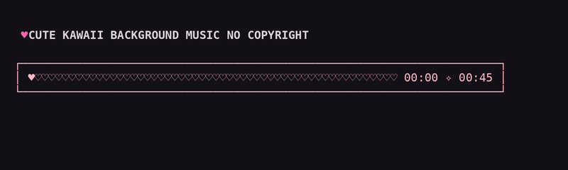

# yt-player ♥

Escuchá música directamente de YouTube en tu terminal. **Sin anuncios**, sin app pesada, sin cuenta. Escribís `yt nombre de la canción`, se encola, suelta la terminal al toque, y una **barra de progreso kawaii** se dibuja sobre la canción que está sonando — reescribiéndose en su lugar, sin escupir líneas nuevas.

Simple, sin systemd, sin base de datos. Solo bash, Python, mpv y yt-dlp.

## Requisitos

yt-player corre en cualquier Linux o macOS con bash. El script de instalación detecta e instala las dependencias que falten automáticamente.

### Distros soportadas

El instalador reconoce tu gestor de paquetes y hace todo por vos:

| Distro | Gestor | ¿Instala deps? |
|--------|--------|----------------|
| Debian / Ubuntu / Mint | `apt` | ✅ |
| Fedora / RHEL / CentOS | `dnf` | ✅ |
| Arch / Manjaro / EndeavourOS | `pacman` | ✅ |
| macOS | `brew` | ✅ |

Si usás otra distro (Alpine, Gentoo, Void, etc.), el instalador te avisa qué dependencias instalar a mano y sigue con el resto.

### Windows

Windows nativo no funciona — yt-player usa `bash`, `flock` y rutas Unix (`~/.local/bin`). Pero con **WSL** (Windows Subsystem for Linux) o **MSYS2** debería andar sin problemas. Instalá una distro de WSL (Ubuntu la más fácil) y seguí las instrucciones de Linux normalmente.

### Dependencias

| Herramienta | Para qué | Cómo la consigue install.sh |
|-------------|----------|------------------------------|
| `python3` | worker + barra | gestor de paquetes |
| `mpv` | reproduce el audio | gestor de paquetes |
| `ffmpeg` | extrae audio (yt-dlp) | gestor de paquetes |
| `yt-dlp` | busca y descarga | binario standalone de GitHub |

Todas se instalan automáticamente durante `install.sh` — no necesitás hacer nada a mano.

## Cómo se ve


```
  ♥ CUTE KAWAII BACKGROUND MUSIC NO COPYRIGHT

  ┌────────────────── rosa claro ──────────────────┐
  │ ♡♡♡✧♡♡♥♡♡♡♡♡♡♡♡♡♡♡♡♡♡♡♡♡♡♡♡♡  01:23 ✧ 03:45 │
  └────────────────────────────────────────────────┘
```

- La parte ya reproducida: corazones ♡ (lila) con ✧ que parpadean suavemente
- La cabeza de la barra: ♥ (rosa fuerte) que avanza con el tiempo real
- La parte pendiente: ♡ tenues (gris)
- Caja con borde rosa; tiempos en cada extremo

La barra lee el tiempo real del socket IPC de mpv y se **reescribe en su lugar** (sube el cursor y borra), no apila líneas nuevas. El ancho total es constante en cada frame, así el bloque de tiempos nunca se mueve.



## Instalación (una línea)

```bash
curl -fsSL https://raw.githubusercontent.com/jefetejon/yt-player/main/install.sh | bash
```

El instalador:
1. Detecta e instala las dependencias que falten
2. Copia el código a `~/.local/lib/yt-player/`
3. Crea los comandos `yt` y `ytq` en `~/.local/bin/`
4. Verifica que `~/.local/bin` esté en tu PATH

### O si ya tenés el repo clonado

```bash
./install.sh
```

## Uso

```bash
yt the girl from ipanema     # busca, descarga el audio y encola
yt fly me to the moon        # se suma a la cola si ya hay algo sonando

ytq                          # muestra qué suena y qué viene
ytq -c                       # vacía la cola (no toca la actual)
ytq -p                       # vacía la cola Y detiene la actual
```

La primera canción arranca sola; las siguientes esperan su turno. Cuando cerrás la terminal, el worker muere con ella — no queda nada en background.

## Cómo funciona

```
yt (bash)                 yt-queue-enqueue.sh (bash)     yt-queue-worker.py (python)
┌────────────────┐        ┌───────────────────────┐      ┌────────────────────────┐
│ busca en YT    │        │ mete en queue.tsv     │      │ lee la cola            │
│ descarga audio ├───────►│ despierta al worker   │─────►│ mueve audio a playing/ │
│ (yt-dlp)       │        │ (flock = 1 solo)      │      │ toca con mpv           │
└────────────────┘        └───────────────────────┘      │ dibuja yt-bar.py       │
                                                          └───────────┬────────────┘
                                                                      ▼
                                                              yt-bar.py (python)
                                                       lee time-pos del socket IPC de mpv,
                                                       reescribe la barra en su lugar
```

- **Sin systemd, sin daemon persistente.** El worker se lanza desde tu terminal, hereda el TTY, y muere cuando la cerrás.
- **Un solo worker a la vez.** Un lock `flock` garantiza que no haya dos compitiendo por el audio.
- **Cola atómica.** Cada `pop` del `queue.tsv` está protegido por `flock`, así varias terminales pueden encolar sin pisarse.
- **Estado en un solo lugar:** `~/.local/state/yt-queue/` (configurable con `YTPLAYER_STATE`).

## Configuración

Variables de entorno (opcionales — todo tiene defaults sensatos):

| Variable | Default | Para qué |
|----------|---------|----------|
| `YTPLAYER_HOME` | `~/.local/lib/yt-player` | dónde vive el código |
| `YTPLAYER_BIN` | `~/.local/bin` | dónde van los comandos |
| `YTPLAYER_STATE` | `~/.local/state/yt-queue` | cola, logs, audio temporales |
| `YTPLAYER_MPV` | autodetectado | ruta a mpv si no está en el PATH |
| `YTPLAYER_YTDLP` | autodetectado | ruta a yt-dlp si no está en el PATH |

## Requisitos del terminal

- Glifos que se ven bien: `♥ ♡ ✧ ─ │ ┌ ┐ └ ┘`. Con una Nerd Font o cualquier fuente mono con soporte Unicode andá sobrado. (Probado con JetBrains Mono Nerd Font y DejaVu Sans Mono.)
- La barra usa códigos ANSI de 256 colores; no necesita truecolor.

## Desarrollo

```
yt-player/
├── install.sh              # instalación de una línea
├── src/
│   ├── yt.sh               # cliente: busca, descarga, encola (+ subcomandos ytq)
│   ├── ytq.sh              # wrapper fino para la cola
│   ├── yt-queue-enqueue.sh # mete en queue.tsv y despierta al worker
│   ├── yt-queue-worker.py  # worker: cola → playing/ → mpv → barra
│   └── yt-bar.py           # la barra kawaii (lee IPC de mpv)
├── docs/
│   ├── yt-player-demo.gif  # demo completa del flujo
│   └── kawaii-bar.gif      # la barra en acción
├── LICENSE
└── README.md
```

Para probar cambios localmente sin reinstalar:

```bash
export YTPLAYER_HOME="$(pwd)/src"
export YTPLAYER_STATE="/tmp/yt-player-test"
export YTPLAYER_MPV="$(command -v mpv)"
export YTPLAYER_YTDLP="$(command -v yt-dlp)"
yt algo
```

## Licencia

MIT — hacé lo que quieras. ♥
